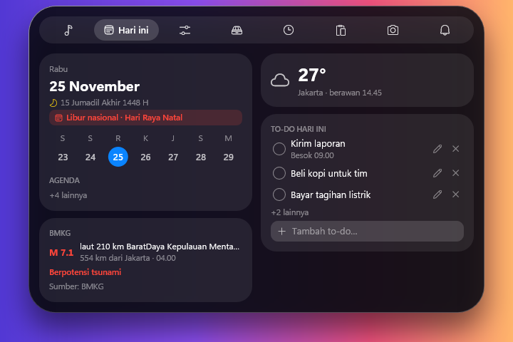
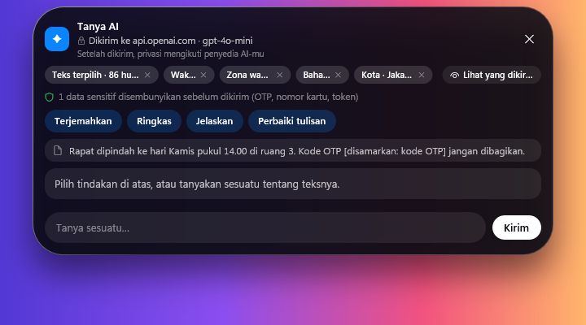
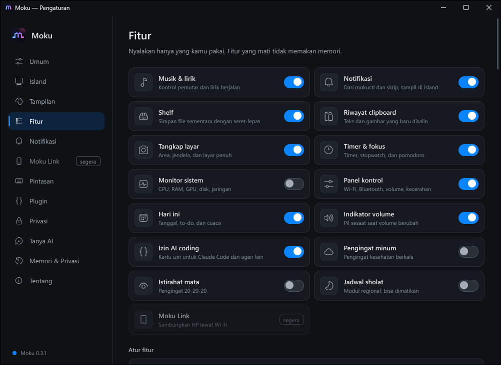
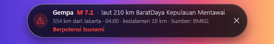

# Moku

Moku is a **dynamic island for Windows**: a small glass pill at the top of the screen that shows what
is going on and opens into a panel when you point at it. It is written in Rust, runs on Windows 10
(1903+) and 11, needs no account, has no server, and keeps everything on your PC. The interface is
Indonesian by default; English is available.

| Hari ini (today, BMKG, weather, to-dos) | Tanya AI (any OpenAI-compatible provider) |
|---|---|
|  |  |

| Settings | Earthquake alert from BMKG |
|---|---|
|  |  |

The screenshots use sample data only. The design mockups are in [`pratinjau/`](pratinjau/).

## What it does

- **Live pills:** music with controls, timers and focus, calls, charging, Bluetooth earbuds battery,
  downloads, volume, Caps Lock, calendar heads-up (ICS), Windows notifications (masked OTP codes).
- **Panel tabs:** media, Hari ini (date, Hijri date, holidays, agenda, weather and air quality, to-dos
  with due times), Kontrol (tiles, sliders, per-app volume mixer), Shelf (files, with a converter),
  timers, clipboard history with smart actions, screen OCR, notifications.
- **Launcher** (`Alt+Space`): apps, calculator, `todo …`, `timer 10m`, settings pages, Shelf files.
- **Tanya AI** (`Ctrl+Alt+A`): translate, summarise, explain or fix selected text with any
  OpenAI-compatible provider (OpenAI, OpenRouter, Groq, Gemini, DeepSeek, or local Ollama / LM Studio).
  Sensitive data is masked before sending, the card shows exactly what is sent and where, and the
  memory is encrypted on your PC.
- **Ibadah:** prayer times (Kemenag / JAKIM), Ramadan imsak and iftar countdown, optional adzan sound
  from your own file (none is bundled), sunnah fasting reminders.
- **BMKG** earthquake and tsunami alerts, exchange rates.
- **Coding agents:** live status and permission cards for Claude Code, Codex CLI and Gemini CLI.
- **Send to phone** over your Wi-Fi with a QR code (refused on public networks).
- **Polite island:** moves aside from the pointer, hides until the top edge, follows the monitor you use.
- A settings app, a per-user installer with signed updates, and the `mokuctl` command line.

Every feature can be switched off, and a switched-off feature costs nothing. Idle, Moku uses about
45 MB of working set and 0% CPU.

## Install

Download `moku-setup.exe` from the [latest release](https://github.com/dikaproject/MokuApp/releases/latest)
and run it: it installs for your account only (no admin rights) and can start Moku with Windows. A
portable zip is attached too. Releases are not code-signed yet, so Windows SmartScreen may warn the
first time: *More info → Run anyway*, or compare the installer's SHA-256 with
`moku-setup.exe.sha256` from the same release. Signing starts with the first release made after
SignPath approves the project; see the [Code signing policy](CODE_SIGNING_POLICY.md). What Moku sends
over the network, and when, is in the [privacy policy](PRIVACY.md).

## Build from source

Rust (the version in `rust-toolchain.toml`, MSVC toolchain) and the Visual Studio Build Tools:

```powershell
cd app
cargo build --release --locked
cargo test --workspace --locked
```

Everything else (features, `mokuctl`, configuration, the coding-agent hooks, network use, privacy,
releasing) is in [`app/README.md`](app/README.md); how the code is organised is in
[`app/docs/ARCHITECTURE.md`](app/docs/ARCHITECTURE.md). Changes are listed in [`CHANGELOG.md`](CHANGELOG.md).

## Forks, credit and the name

Moku is open source so you can learn from it, fix it and improve it. **Open source is not "free to
take".** The licence below gives you real freedoms and real obligations:

- **Keep the credit.** Every copy or modified version must keep [`NOTICE`](NOTICE) and show, on its
  about page, that it is based on Moku with a link to the official repository:
  <https://github.com/dikaproject/MokuApp>.
- **Keep it open.** If you share a modified version (free or paid), you must share its full source
  code under the same GPL-3.0 licence. Moku cannot be turned into a closed-source product.
- **Use your own name and icon.** A modified version must not present itself as Moku. The logo is
  GPL-3.0 like the rest of the code, but you get no right to use the name "Moku" or the Moku logo
  to identify a modified version.

The best way to help is a pull request or an issue here, so everyone gets the improvement.

> **Bahasa Indonesia:** Silakan pelajari, ubah, dan bagikan Moku, tapi open source bukan berarti
> bebas diambil begitu saja. Setiap salinan atau versi ubahan wajib mencantumkan kredit dan tautan ke
> repo resmi (https://github.com/dikaproject/MokuApp), wajib tetap open source dengan lisensi GPL-3.0
> (termasuk kalau dijual), dan wajib memakai nama serta ikon sendiri. Logo Moku ikut berlisensi
> GPL-3.0 seperti kode lainnya, tetapi nama "Moku" dan logonya tidak boleh dipakai untuk menamai
> versi ubahan. Kalau mau menambah fitur, kirim pull request ke sini supaya semua orang ikut
> menikmatinya.

## Code signing policy

Releases are signed from the first one made after SignPath approves the project (none is signed yet).
Who may approve a signing request, what is signed and how releases are built is in [`CODE_SIGNING_POLICY.md`](CODE_SIGNING_POLICY.md).
The privacy policy (what Moku sends over the network, and when) is in [`PRIVACY.md`](PRIVACY.md).

## License

Copyright © 2026 Moku contributors. Moku is free software under the
[GNU General Public License version 3](LICENSE), with the additional terms in [`NOTICE`](NOTICE)
(GPL section 7: attribution, marking modified versions, and no right to use the name or logo to
identify a modified version). The logo files are GPL-3.0 like everything else. It comes with no warranty.

Moku uses [Slint](https://slint.dev) for the settings window and the installer, under the GPL-3.0.
